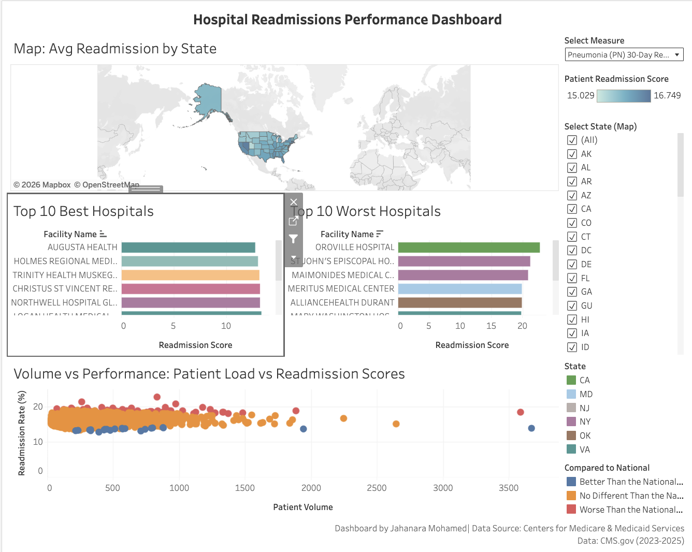
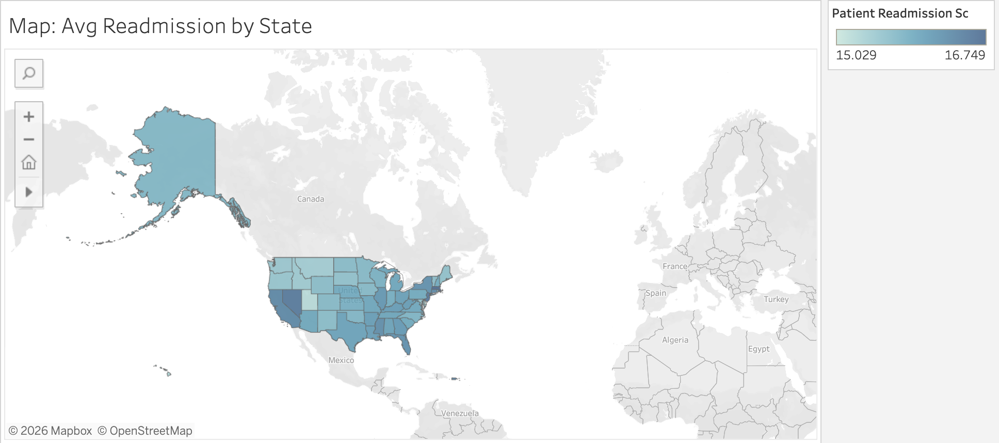
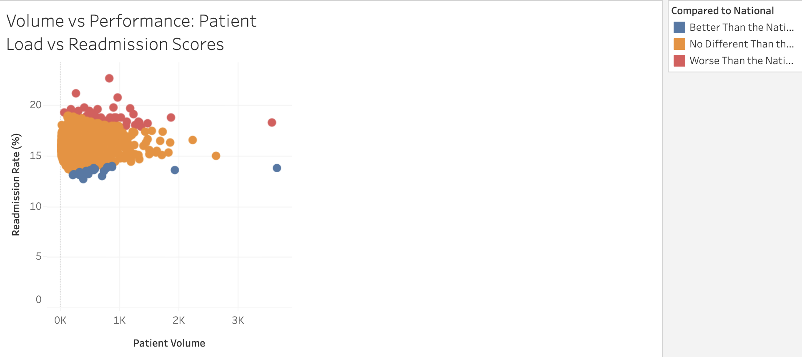

# Hospital Readmissions Performance Dashboard

This dashboard was built to analyze hospital readmission rates using publicly available data from the Centers for Medicare & Medicaid Services (CMS), primarily to identify performance patterns across U.S. hospitals for three key measures: heart failure readmissions, pneumonia readmissions, and all-cause readmissions. The interactive dashboard allows healthcare stakeholders such as quality improvement teams, hospital administrators, and policy makers to explore geographic trends, compare hospital performance, and understand the relationship between patient volume and readmission outcomes.

---

## Business Problem

Hospitals with higher than expected readmission rates face financial penalties. This dashboard helps answer questions like:

- Which states have the highest/lowest readmission rates?
- Which hospitals are the best and worst performers?
- Is there a relationship between patient volume and readmission outcomes?
- How do different conditions (heart failure, pneumonia, all-cause) compare?

---

## Data Source

- **Dataset:** [CMS Unplanned Hospital Visits – Hospital](https://data.cms.gov/provider-data/dataset/632h-zaca)
- **Time Period:** July 2023 – November 26, 2025
- **Measures Used:**
  - Heart failure (HF) 30-Day Readmission Rate
  - Pneumonia (PN) 30-Day Readmission Rate
  - Hybrid Hospital-Wide All-Cause Readmission Measure (HWR)
- **Source file:** 67,074 rows covering 4,791 hospitals (one row per hospital per measure), downloaded February 2026.
- **Hospitals in analysis:** 4,230 (4,221 hospital-wide · 3,641 pneumonia · 3,156 heart failure)

---

## Tools Used

- **PostgreSQL** – Data cleaning, transformation, and creation of analysis-ready views
- **Python (pandas, sqlalchemy, psycopg2)** – Importing raw CSV data into PostgreSQL
- **Tableau Public** – Building the interactive dashboard

---

## Methodology

1. **Data Acquisition:** Downloaded the CMS Unplanned Hospital Visits – Hospital CSV.
2. **Data Import:** Used a Python script to load the CSV into a PostgreSQL database, handling missing values and data type issues.
3. **Data Cleaning & Transformation:** Created SQL views to:
   - Convert text scores to numeric values.
   - Extract patient volume from the `Denominator` column (since `Number of Patients` contained "Not Applicable" for readmission rates).
   - Filter to the three measures of interest and keep only the most recent data per hospital and measure.
   - Remove rows without a numeric score (too few cases or not reported), which left 4,230 of 4,791 hospitals.
4. **Export for Tableau:** Exported the final view to a CSV file.
5. **Dashboard Design:** Built an interactive dashboard in Tableau Public with:
   - A map showing average readmission scores by state.
   - Bar charts for top 10 best and worst performing hospitals.
   - A scatter plot exploring patient volume vs. readmission scores.
   - Interactive filters for measure, state, and comparison category.

---

## Key Insights

- **Rates vary meaningfully across hospitals.** Heart failure readmission rates range from 14.3% to 26.6% (average 19.7%), pneumonia from 12.7% to 22.7% (16.0%), and hospital-wide from 11.7% to 19.3% (15.0%).
- **Specialty hospitals have the lowest hospital-wide rates (11.7%–12.9%).** Orthopedic and surgical hospitals such as New England Baptist Hospital and Hospital for Special Surgery lead this measure, likely reflecting lower-risk elective patients. They do not report heart failure or pneumonia, so they are excluded from those comparisons.
- **Patient volume has almost no relationship with readmission rates.** Correlation is −0.04 for heart failure, 0.01 hospital-wide, and 0.13 for pneumonia (weak). High- and low-volume hospitals appear across the full range.
- **Over 90% of hospitals are statistically indistinguishable from the national rate.** 96.4% for heart failure, 97.7% for pneumonia, and 91.9% hospital-wide. CMS flags a hospital only when its difference is statistically clear, so true outliers are rare.
- **Pneumonia outliers skew worse.** 60 hospitals are worse than the national rate versus 22 better, about 3 to 1. Heart failure is balanced (57 worse, 56 better).
- **Data validation note:** an early version of the dashboard summed rates across measures, which inflated scores for hospitals reporting all three measures and made single-measure specialty hospitals look best. The dashboard now ranks hospitals within one measure using average rates.

---

## Dashboard Preview
*Screenshots show the **Pneumonia (PN) 30-Day Readmission Rate** measure selected. Use the "Select Measure" dropdown in the live dashboard to switch to heart failure or hospital-wide readmissions.*

### Full Dashboard

### Map View (Average Score by State)

### Scatter Plot: Patient Volume vs. Readmission Score

---

## Live Dashboard

[Click here to view the interactive dashboard on Tableau Public](https://public.tableau.com/app/profile/jahanara.mohamed/viz/HospitalReadmissionsPerformanceDashboard/ReadmissionsOverview)

---
